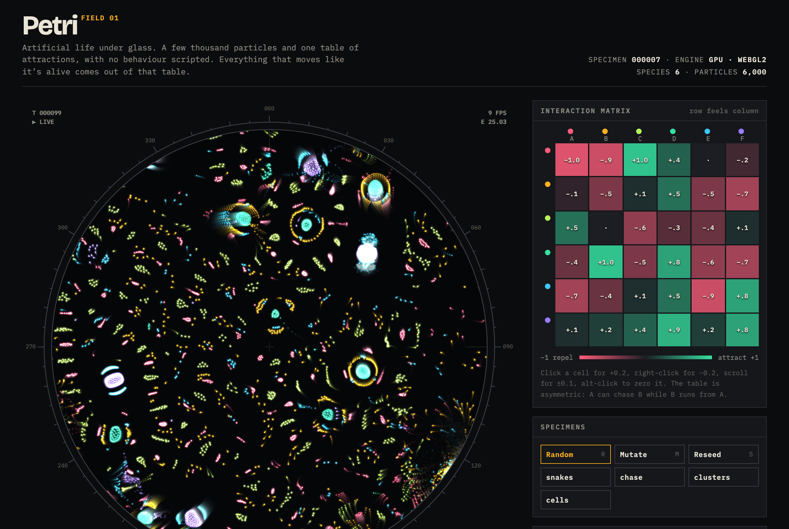

# Petri

**An artificial-life microscope: thousands of particles, one table of attractions, and everything that moves like it's alive comes out of that table.**



**[Open the microscope in your browser →](https://thewingthewong.github.io/petri/)** · no install, no sign-up

A few thousand particles of up to 8 species sit on a torus. Each pair within reach feels a
short-range force: everything repels at very close range, and beyond that a K×K **interaction
matrix** sets attraction or repulsion. The matrix is asymmetric (A can chase B while B flees A),
so momentum isn't conserved, and cells, snakes, swarms and predator-prey chases appear with no
scripted behaviour.

Zero dependencies: plain HTML, CSS, ES modules and WebGL2, with no build step.

## Run it

```sh
npm start            # http://127.0.0.1:8080
```

## Play with it

- **Matrix editor:** left-click +0.2, right-click −0.2, scroll ±0.1, alt-click 0. Presets:
  snakes, chase, clusters, cells. Also Random (R), Mutate (M) and Reseed (S).
- **Pipette:** drag in the dish to pull particles, shift-drag or right-drag to push.
- **Sharing:** the URL hash encodes the seed, species count, particle count and matrix
  (one letter per cell), so a copied link opens the same specimen. Photo (P) saves a PNG.
- **Evolution:** press E and let Petri search for life-like tables on its own (see below).
- **Engines:** press G to switch between the GPU and CPU engines live. `?engine=cpu` forces the CPU.

## How it works

- **Engine (`sim.js`):** a counting-sort spatial grid for neighbour search
  (tested against brute force), toroidal wrap, frame-rate-independent friction, and a
  seeded deterministic RNG.
- **GPU engine (`gpu.js`):** WebGL2 GPGPU. Particle state ping-pongs between float
  textures, and one fragment-shader invocation per particle sums forces from all the others. It runs
  10,000+ particles at interactive rates (up to 20,000), and the dots are drawn with additive blending and trails.
  It is used automatically when the browser supports it, with the CPU engine as the fallback.
  A browser test checks that the GPU matches the CPU engine to within about 1e-7 in position.
- **Evolution (`evolve.js`, runs in a Web Worker):** Petri breeds attraction tables with a
  (μ+λ) evolution strategy and scores each one for life-likeness: *lumpiness* (density variance above
  random scatter) × *coordination* (local velocity alignment above chance) × *motion*. Frozen
  crystals and featureless gas both score near zero. An archive keeps the best *distinct* finds as a
  thumbnail gallery that persists across reloads; click a find to load it into the dish. It is evaluated
  on a small world with the same neighbour density as your dish, so the finds behave the same at full size.

## Test it

```sh
npm test             # engine + evolution unit tests (node:test, no install needed)
npm install          # once, for Playwright
npx playwright install chromium
npm run test:e2e     # browser smoke test + GPU-vs-CPU parity check in headless Chromium
```

The unit tests check the spatial grid against brute force, determinism, wrap-around and the
life-likeness score. The browser tests drive the matrix editor, pipette, share links, evolution
gallery and engine hot-swap, then check that the GPU and CPU engines agree step for step.
`node scripts/screenshot.mjs` regenerates the screenshot above.

## Limitations

- The GPU engine sums forces over **all** particles for every particle (O(N²)), not just neighbours.
  That's simple and exact, but it's why the frame rate falls off past ~10,000 particles, and on
  weak or software-rendered GPUs well before that.
- The CPU fallback is capped at 6,000 particles. A larger shared world opened on the CPU keeps
  the same density by using fewer particles and a longer reach, so it looks similar but isn't identical.
- A share link reproduces the **starting** state exactly. The dynamics are chaotic and the GPU uses
  32-bit floats, so after a while the same link drifts apart on different engines or devices.
- "Life-likeness" is a hand-built score (lumpiness × coordination × motion). It rewards structure
  and movement, so evolution sometimes favours busy swarms over the slow, elegant specimens a person would pick.
- Evolution finds are stored in `localStorage`, so they stay in one browser on one machine.

## License

[MIT](LICENSE). The bundled fonts are under the SIL Open Font License 1.1 (see [`fonts/README.md`](fonts/README.md)).
